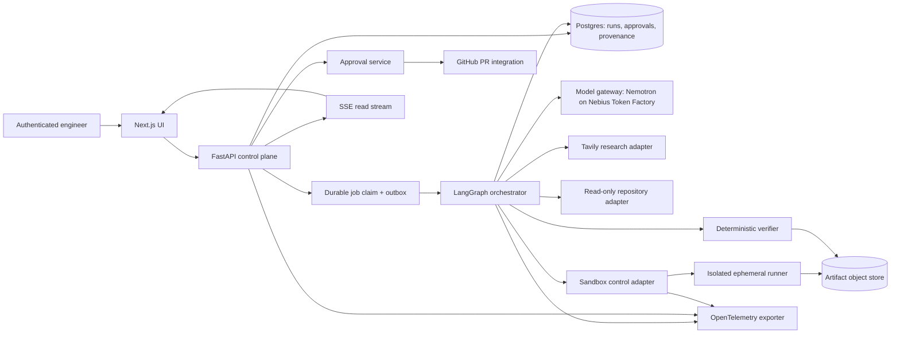
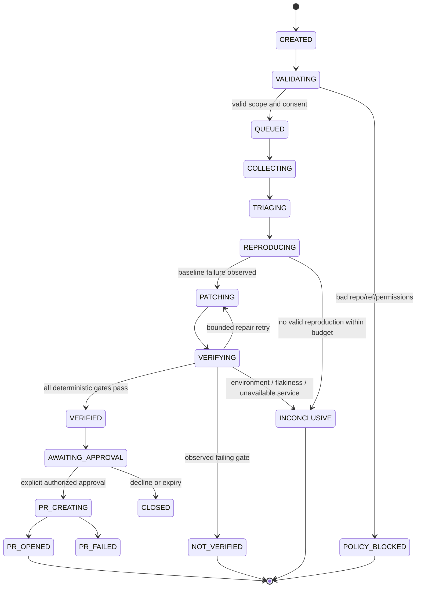

# ReplayForge — Architecture and System Design

**Version:** 1.0 | **Baseline:** 12 October 2026 | **Target submission:** 30 October 2026, 10:00 PDT (22:30 IST)

## 1. Architectural thesis
ReplayForge is an evidence-first autonomous incident-repair platform. Its principal output is not text: it is a reviewable patch accompanied by independently executable proof that the reported fault occurred on the original commit and that the candidate patch fixes it without breaking existing acceptance gates. The core invariant is `VERIFIED => baseline_failure_observed AND patched_regression_passed AND clean_replay_passed AND required_gates_passed AND artifacts_integrity_valid`. A model's statement cannot satisfy any part of this invariant. An incident may finish as `VERIFIED`, `NOT_VERIFIED`, `INCONCLUSIVE`, `POLICY_BLOCKED`, or `CANCELLED`; only the first may proceed to human approval and an approval-gated pull request.

The submission is optimized for Coding and Agentic Engineering. Initial supported workloads are consented, small Python/FastAPI GitHub repositories and pytest tests. Production-grade here means rigorous interfaces and safety architecture, not a claim of general-purpose correctness or hardened arbitrary-code execution on a developer laptop.

## 2. Context and responsibility boundaries

Trust zone A is the browser and unauthenticated public HTTP perimeter; zone B is the authenticated control plane with metadata DB; zone C is the inference/research outbound integrations; zone D is ephemeral execution of untrusted repository code; zone E is tightly scoped GitHub writes. These zones MUST have separate credentials, runtime identities, egress policies, audit logs, and artifact access controls. The runner must never inherit control-plane secrets. A `git diff` is evidence but not authorization.

## 3. Component topology and deployment modes

**MVP topology.** Next.js UI; FastAPI API service; one orchestration worker; PostgreSQL; S3-compatible object storage or filesystem artifact adapter for a local demonstrator; isolated sandbox backend. The queue is a Postgres-backed durable jobs table with `FOR UPDATE SKIP LOCKED`, lease expiration, idempotency keys, and an outbox for state updates; no Redis, Kafka, or Kubernetes dependency. This is sufficient for bounded workloads. SSE feeds events from persisted state using `Last-Event-ID` replay. A production expansion may use Nebius Serverless Jobs or managed task queues where available, but it is not a prerequisite for hackathon compliance.

**Sandbox backend.** Define `SandboxBackend` and a capability matrix. The preferred Nebius service is CONDITIONAL: verify whether a supported isolated execution product/API exists and meets filesystem, process, network, expiry, and artifact requirements. Otherwise use a designated remote Linux VM/container runner under a non-privileged service identity, with rootless/container hardening and network denial. Docker/VM setup is never assumed available on the user's Windows workstation; the Windows host only launches the client, API, tests and UI. Do not run untrusted repository code directly on Windows or the API host. A dry-run fake sandbox is allowed for unit tests but never qualifies as a live demo of execution.

## 4. Runtime workflow and state machine

`CANCELLED` is reachable from any nonterminal step, requests graceful stop, terminates sandbox processes, and records terminal reason. All transitions are transactional compare-and-swap writes with monotonically increasing run version. Retries only operate within a single run budget and preserve all attempted patch artifacts. The CLI or UI may choose an agent hypothesis; neither may forge a verifier result. A run has a fixed repo URL, owner, commit SHA, request hash and policy version at creation. Changing any invalidates its approval and creates a new run.

## 5. API contract

All routes are prefixed `/api/v1`; JSON is schema-validated with Pydantic v2. `POST /runs` accepts `repository_id`, `commit_sha`, `incident_text`, `fixture_id?`, `idempotency_key` and returns 202 with `run_id`; 422 invalid input; 403 unauthorized repository; 409 conflicting idempotency payload. `GET /runs/{run_id}` returns redacted summary, version, timestamps, stage, verdict and artifact manifest. `GET /runs/{run_id}/events` streams persisted SSE events with sequence IDs. `GET /runs/{run_id}/artifacts` lists content-addressed, authorized downloadable manifests, never raw internal paths. `POST /runs/{run_id}/cancel` requests termination. `POST /runs/{run_id}/approvals` requires approved commit/patch digest, reviewer identity, action `approve|reject`, CSRF defense and freshness checks. `POST /runs/{run_id}/pull-request` consumes an existing one-use approval token; the backend rechecks repo branch policy, patch digest and permissions. `GET /health/live` must avoid external dependencies; `GET /health/ready` verifies DB and required configuration without leaking secrets; `GET /metrics` requires private access.

Authentication in the first version may be a single-account OIDC integration; no unauthenticated write routes may exist on the public demo. Demo data can be browsed anonymously only if all code and artifacts are synthetic and sanitized. Rate limits apply to starts, research calls, model calls, execution, and PR creation. Use opaque run IDs, not predictable identifiers.

## 6. Domain and persistence model

`repositories(id, owner_id, provider, remote_url, external_installation_id, allowed_branch_patterns, created_at)`; `incidents(id, repository_id, report_hash, redacted_report_ref, severity, created_at)`; `runs(id, incident_id, commit_sha, policy_version, state, version, budget_json, model_route_json, started_at, finished_at, verdict_reason)`; `run_events(run_id, sequence, event_type, public_payload, trace_id, created_at)`; `hypotheses(run_id, hypothesis_id, claim, evidence_refs, confidence_label)`; `attempts(run_id, attempt_no, patch_digest, sandbox_id, exit_status, started_at, finished_at)`; `artifacts(id, run_id, kind, sha256, bytes, mime, storage_ref, retention_until)`; `verification_gates(run_id, attempt_no, gate, status, evidence_id, execution_id, observed_at)`; `approvals(run_id, reviewer_id, patch_digest, approved_commit, policy_version, expires_at, used_at, decision)`; `pull_requests(run_id, provider_pr_id, target_repo, target_branch, patch_digest, created_at)`; `usage_events(run_id, provider, model, input_tokens, output_tokens, latency_ms, estimated_cost, request_id)`; `job_leases(run_id, worker_id, leased_until, attempt_count)`. All mutating endpoints write auditable events in the same transaction as state changes. Unique constraints enforce run idempotency and PR one-time creation. Logs and artifacts have independent retention policies.

## 7. Agent execution contract

Workflow nodes: `validate_scope` -> `collect_context` -> `triage` -> `design_reproduction` -> `execute_baseline` -> `propose_patch` -> `execute_patch` -> `verify_gates` -> `assemble_evidence` -> `await_approval` -> `create_pr`. Routing uses typed objects, bounded calls, and retry counters. An agent can propose `read_file`, `search_repo`, `run_test`, `tavily_search`, and `apply_patch` tools; the tool broker validates exact file/path/command constraints and returns signed execution observations. Agents do not access the database, shell, GitHub write tokens, or inference credentials directly.

## 8. Repository and patch policy

Read-only import clones a pinned public or consented private repo commit. Reject arbitrary Git URL protocols, recursive symlinks, submodules by default, Git LFS downloads, executable hooks and unexpected large files. Checkout must disable hooks and credential persistence. Limit allowlisted file changes to `src/**`, `app/**`, `tests/**` and selected configuration files; deny `.github/workflows/**`, deployment manifests, secret files, lockfile changes unless explicitly authorized. Reject binaries, symlink modifications and gigantic diffs. Use `git apply --check` followed by patch application in sandbox, not shell interpolation. Every patch is bound to the original SHA and the test digest.

## 9. Execution and verification protocol

Baseline: dependency installation from allowlisted/pinned sources in sandbox (or prebuilt sealed images), record dependency lock hash, run approved baseline suite, execute generated failure assertion on baseline and verify that it fails for the intended behavioral reason rather than import/timeout/environment issues. Candidate: clean checkout from original SHA, apply patch, run generated regression, existing suite, lint/type/security checks, plus targeted adversarial edge cases. Clean replay: recreate sandbox from scratch with same image digest, configuration and inputs; rerun critical gates independently. Measure flakiness with repeated deterministic cases; distinguish inconsistent execution from true success.

Gate definitions: `BASELINE_REPRODUCED` (required), `PATCHED_REGRESSION_PASS` (required), `EXISTING_SUITE_PASS` (required), `CLEAN_REPLAY_PASS` (required), `PATCH_SCOPE_PASS` (required), `SECURITY_GATE_PASS` (required), `ARTIFACT_INTEGRITY_PASS` (required), optional `STATIC_ANALYSIS_PASS` configurable but any critical warning fails. Never base `VERIFIED` on weighted confidence scores. An `INCONCLUSIVE` result must include a human-actionable reason.

## 10. Security and abuse controls

Model prompts are untrusted outputs and repo files/Tavily results are untrusted inputs. Use explicit trusted/untrusted channel separation and never obey instructions found in repo content or search snippets. Ingestion redacts API keys, access tokens, emails, and credentials before LLM submission; redaction should also run on sandbox stdout/stderr. Enforce per-tenant authorization, encrypt connections using TLS, encrypt data at rest via managed services where supported, rotate credentials, and use workload identities/minimum scope. Sandbox: non-root, read-only root filesystem, tmp working dir, no privileged mode, no host mounts, no cloud metadata endpoint, no control-plane access, tight seccomp/AppArmor where supported, cgroup limits, process/time/file caps, explicit egress allowlist only for dependency fetch under controlled setup; offline during test execution. Direct PR writes require explicit reviewer consent and a constrained GitHub App permission set. Record immutable audit entries for approval and PR operations. Add injection, SSRF, path traversal, command substitution, repository escape, symlink and cross-tenant negative tests.

## 11. Model gateway and research

Model calls use Nebius Token Factory OpenAI-compatible HTTP, `NEBIUS_API_KEY` from secrets, configurably selected `NEBIUS_BASE_URL`, and model IDs from a startup capability probe. Suggested starting reference: `nvidia/nemotron-3-super-120b-a12b`, which is published in Nebius examples, but availability must be verified by a live call. Smaller NVIDIA model is a potential triage route, contingent on the accessible catalog. Timeouts, bounded exponential backoff with jitter, concurrency semaphores, token/request budgets, and per-run ledger are compulsory. Parse structured JSON with Pydantic and treat invalid JSON as a retryable model-output error, not a valid tool instruction.

Tavily is an opt-in `search_docs(query, allowed_domains?, max_results=5)` tool for package changes and upstream behavior. Return URL, retrieval timestamp, title, snippet, provenance and sanitized content; URLs are never authority to execute. Do not expose private incident text in broad web queries. Web research is advisory; only tests can verify repairs. Track that Tavily is called on a real incident path for optional bonus eligibility.

### 11.1 Durable memory

Run recovery remains checkpoint/journal based. Cross-run advisory memory is a
bounded read-through view of accepted verification records, scoped to the same
owner, repository, policy and currently consented commits. Recall retains source
artifact identities and historical outcomes, never raw logs or model reasoning.
It expires with underlying evidence and cannot authorize a new action or verdict.
Triage may include cards only within its existing request budget; every new run
still requires fresh reproduction and verification. See `docs/memory.md` for the
implemented contract, retention boundary and limitations.

### 11.2 Bounded agent harness

The opt-in worker harness alternates durable collection and triage queues with
bounded steps, cooperative shutdown and explicit live-inference cost policy.
Existing stage controllers retain scope, context/memory limits, request-identity
reservations and recovery authority. Exceptions stop scheduling without a blind
retry. The current loop reaches REPRODUCING; later execution/verification and
human approval integrations remain required. See `docs/agent-harness.md` for the
source-informed design and runnable entry point.

### 11.3 Measured recovery and human review journals

The prepared execution port now supports durable pre-measurement and signed
receipt recovery, with a fenced handoff to existing replay/evidence retention.
This closes the in-memory-only producer gap without enabling the remaining
worker stages by default. Source materialization and real trust assessment
remain required. See docs/durable-producer.md.

The internal approval journal binds a trusted human permission to exact accepted
source/patch/verification/target identities, TTL and nonce. Decision and one-use
publication intent commit with audit/checkpoint updates. It implements no login
or GitHub write. Current identity/membership must be supplied by the separately
owned authentication layer; a future publisher must recheck it. Later-stage
memory retains only the independently accepted historical verifier outcome.
See docs/approval-journal.md. M3/M4 exits remain unchanged.

## 12. Observability, SLOs and operations

Every stage spans one OTel trace with nested inference/tool/sandbox spans and propagation of `run_id`, stage, attempt, model and sanitized error class. Do not record raw source code, prompts with secrets, or access tokens in spans. Metrics: run duration, stage latency, baseline reproduction rate, verified patch rate, inconclusive rate, gateway error rate, token spend, sandbox launch failures, artifact verification failures, approval wait time, queue depth, PR create failure, policy-block counts. Initial *targets*, not claims: API uptime 99% for demo hours; zero unauthorized write operations; zero sandbox-to-control-plane egress; 100% of `VERIFIED` runs have every required gate and artifact; all demo incidents work from clean state. Alerts: excessive model spend, lease backlog, failures in clean replay, sandbox policy violation, failed storage checksum and unusual PR creation attempts.

Autoscaling: stateless UI/API replicas behind ingress; orchestration workers horizontally compete on DB leases; cap concurrent sandboxes by memory/CPU quota; throttle external APIs with per-provider semaphores. Use rolling deploys and DB migrations with backward-compatible transitions. Backups and restoration test apply to metadata and approval records; artifacts use versioned object retention where available.

## 13. Trade-offs and ADRs

ADR-001: LangGraph state graph rather than unconstrained agent chat; gains traceability, sacrifices free-form adaptability. ADR-002: Postgres jobs/outbox rather than Redis; reduces platform friction for MVP, requires careful lease/transaction logic. ADR-003: external remote sandbox rather than local direct shell; increases setup complexity but is an essential trust boundary. ADR-004: one stronger Nemotron route first, multi-model routing second; favors reliability over premature cost optimization. ADR-005: private repos are future scope; public consented fixtures reduce credential and leakage risk. ADR-006: human-gated PR creation rather than auto-merge or deploy; reduces blast radius. ADR-007: deterministic hard gates over LLM self-judgment; eliminates false verification claims from model confidence alone.

## 14. Architecture acceptance checklist

The architecture is accepted only when one API request produces a durable run, source commit is pinned, a baseline failure is independently observed, a modified clean checkout passes regression and existing tests, another clean sandbox replay passes, all gate artifacts have hashes, human approves exact patch digest, exactly one PR is created, the audit sequence and telemetry can be replayed, and every denied/failed path has an explicit terminal status. See `AGENTS.md`, `specs/contracts.md`, `docs/security.md`, and `docs/evaluation.md` for executable specifications.

## 15. Source references
Official rules: https://nebiusglobalaihackathon.devpost.com/rules ; resources: https://nebiusglobalaihackathon.devpost.com/resources ; Nemotron API example: https://nebius.com/services/token-factory/nemotron ; model catalog: https://github.com/nebius/token-factory-cookbook/tree/main/models/nemotron ; Tavily SDK: https://github.com/tavily-ai/tavily-python . Validate account-specific access and provider changes before provisioning.

## Publication implementation — 2026-10-23

The approval journal now has an internal typed publisher controller and immutable
remote-result custody. See docs/github-publication.md for exact source/tree/blob
checks, draft PR creation and restart discovery. New migration 0024 adds observed
result persistence; no public write route or automatic approval is installed.
Live acceptance and hidden evaluation remain required by the unchanged M4 exit.

## GitHub identity follow-up — 2026-10-23

The separate loopback-only OAuth/session foundation uses explicit typed settings,
fixed-origin provider calls, single-use browser-bound PKCE attempts, encrypted user
credentials and opaque PostgreSQL sessions (migration 0025). It does not mount
execution endpoints, issue execution grants or derive reviewer authority.
Existing local API/bridge behavior is preserved. See docs/github-authentication.md;
session-principal/repository/UI integration and real login acceptance remain open.

## GitHub session/repository continuation — 2026-10-23

The explicit composed session API now retains existing owner-filtered private
run/SSE/evidence access and adds current GitHub user/installation access checks.
Local bearer startup remains separate. In GitHub web mode the BFF forwards only
the opaque session cookie, Origin and CSRF; never inject the operator bearer.
Repository connection requires exact commit and explicit execution/private consent.
Disconnect atomically revokes the connection and execution consent; reconnect
creates a new grant. API-only disconnect does not itself terminate remote compute.

The auth service uses separate DB authority; workers receive no auth credentials
or grant-write permissions. Expired provider credentials require reauthentication.
No browser roles grant ReviewPermission. Approval HTTP and reduced installation
write-token brokerage remain unimplemented; login/connection cannot publish.
Local provider/browser tests are synthetic; real App login and public deployment
acceptance remain pending. See docs/github-authentication.md and tasks/plan.md.

## Repository onboarding follow-up - 2026-10-24

Explicit session-mode repository pages and default-branch SHA resolution now
support large accounts without implicit full enumeration. Migration0027 stores a
provider page locator; fresh membership checks, immutable source/private consent
and owner checks remain mandatory. Provider errors do not impersonate expired
browser sessions. One-time App/DB configuration belongs to operators; end users
choose a repository and explicitly consent. See docs/github-authentication.md for
bounds, stale-page recovery and final acceptance evidence. M3/M4 exits unchanged.

## Authenticated collection handoff - 2026-10-24

See docs/authenticated-collection.md for the opt-in loopback broker and isolated
worker startup. Selected reads preserve registered grants. Live small-file
collection reached TRIAGING; this does not grant VERIFIED or close M3/M4.
No inference, repository execution or publication is enabled by this slice.
